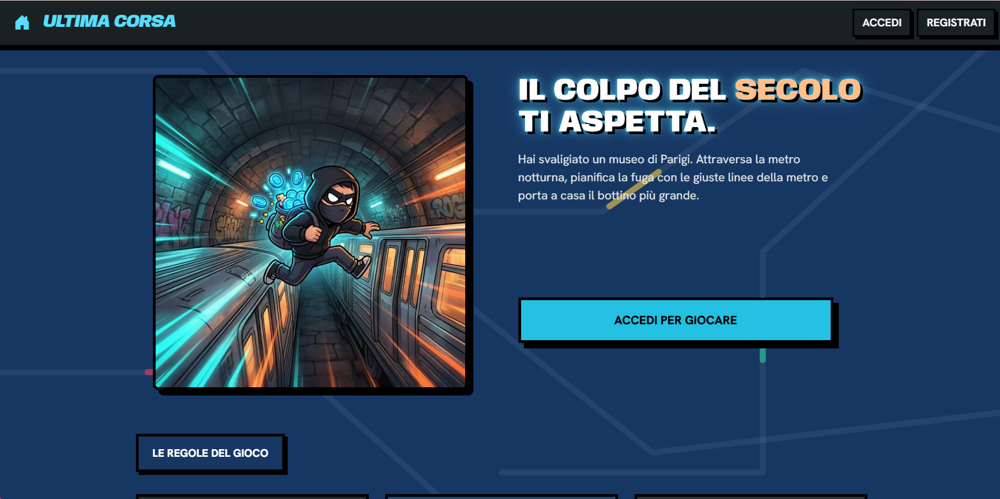
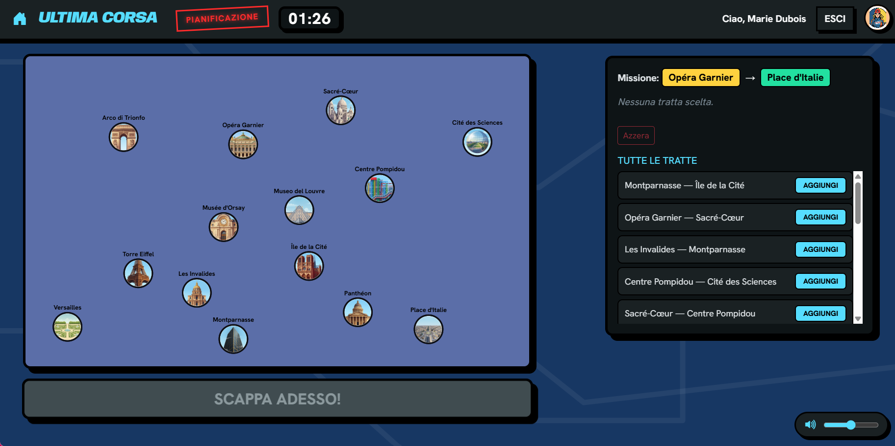
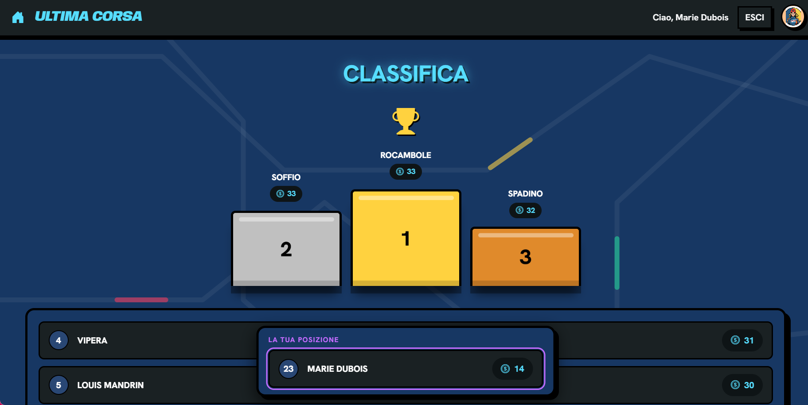

# Ultima Corsa
An interactive web-based strategy game where a master thief who just pulled off a museum heist in Paris must navigate the underground metro network, dodge the police, and escape before dawn!


## About the  Game
Ultima Corsa is a comic-style and simple game. After stealing priceless artifacts (like the Mona Lisa or the Crown of Thorns), players must plan their escape route across the complex Paris metro graph.

- Plan Your Route: Use the interactive map and draggable tract cards to build your escape path. Beat the 90-second countdown timer!

- Survive Events: Every stretch of the journey brings random events—from romantic couples blocking the platform to police checkpoints or finding hidden jewelry trunks.

- Score & Leaderboard: Manage your loot, avoid getting caught, and compete for the top spot on the global leaderboard.







## Tech Stack
- Frontend: React, React-Router, React-Bootstrap, Custom CSS.
- Backend: Node.js, Express, RESTful APIs.
- Database & Auth: SQLite, Passport.js (session-based authentication with salted password hashing).

## How to Run Locally
To run this project locally, you need to have Node.js and npm installed on your machine.

The project uses a two-server architecture (separate client and server), so you need to open two separate terminal windows.

- Terminal 1 (Server): 
    ```
    cd server
    npm install
    node init-db.mjs
    nodemon index.js
    ```

- Terminal 2 (Client): 
    ```
    cd client
    npm install
    npm run dev

(The client will run on http://localhost:5173)

## Users Credentials
You can log in using one of the pre-registered accounts in the database:

| Email | Password | Username | Level |
|-------|----------|----------|---------|
| marie.dubois@paris.fr | password | Marie Dubois | 0 |
| arsene.lupin@paris.fr | password | Arsène Lupin | 1 |
| vidocq@paris.fr | password | Eugène Vidocq | 1 |
| josephine.balsamo@paris.fr | password | Joséphine Balsamo | 0 (no games played) |
| fantomas@paris.fr | password | Fantômas | 11 |
| belphegor@paris.fr | password | Belphégor | 12 |
| cartouche@paris.fr | password | Cartouche | 4 |
| mandrin@paris.fr | password | Louis Mandrin | 19 |
| rocambole@paris.fr | password | Rocambole | 20 (max) |

The password for all users is `password`.

## System architecture

### React Client Application Routes

- Route `/`: Home. Displays game instructions to everyone. **Anonymous** users see only the instructions (without the map) and a prompt to log in; **logged-in** users also see "New Game" and "Leaderboard" buttons.
- Route `/login`: Displays the login form.
- Route `/register`: Displays the registration form (email, username, and password entered twice); the user is automatically logged in after registration.
- Route `/play`: Displays the game [protected]. It begins with selecting the difficulty level, after which all phases (reconnaissance, planning, execution, result) take place within this single route, managed by internal state.
- Route `/leaderboard`: Displays the overall leaderboard (best score per user) [protected].
- Route `/profile`: Displays the logged-in user's profile and player statistics [protected].
- Route `*`: "Not Found" page.

Protected routes redirect to the home page (/) if the user is not authenticated.

### API Server

All game, map, and leaderboard APIs are **protected** (logged-in users only) by an `isLoggedIn` middleware that returns a **401** status if the session is missing.

- POST `/api/sessions` - Create a new session (i.e., log in).
  - request body: `{ username: string, password: string }`
  - response body: `{ id: number, username: string, name: string, avatar: string|null }`
  - response: `201 Created` (success) or `401 Unauthorized` (failure, wrong credentials)

  - request body example: `{ "username": "marie.dubois@paris.fr","password": "password" }`
  - response body example (in case of success): `{ "id": 1, "username": "marie.dubois@paris.fr", "name": "Marie Dubois", "avatar": "/Avatars/avatar3.png" }`


- POST `/api/users` - Registers a new user and immediately starts the session (automatic login). The username (`name`) must be unique.
  - request body: `{ email: string, username: string, password: string }`
  - response body: `{ id: number, username: string, name: string, avatar: string|null }`
  - response: `201 Created` (success), `409 Conflict` (email o username già in uso) or `422 Unprocessable Entity` (dati non validi)

  - request body example: `{ "email": "newuser@paris.fr", "username": "Il Falco", "password": "segreta1" }`
  - response body example (in case of success): `{ "id": 10, "username": "newuser@paris.fr", "name": "Il Falco", "avatar": null }`


- GET `/api/sessions/current` - Checks the current session.
  - request body: None
  - response body: `{ id: number, username: string, name: string, avatar: string|null }`
  - response: `200 OK` (success) or `401 Unauthorized` (failure, not authenticated)

  - response body example (in case of success): `{ "id": 1, "username": "marie.dubois@paris.fr", "name": "Marie Dubois", "avatar": "/Avatars/avatar3.png" }`


- DELETE `/api/sessions/current` - Delete the session.
  - request body: None
  - response body: None
  - response: `200 OK` (success).


- GET `/api/map` - Retrieves the entire metro network (stations, lines, tracts).
  - request body: None
  - response body: `{ stations: [{ id: number, name: string, pos_x: number, pos_y: number }], lines: [{ id: number, name: string, color: string }], tracts: [{ id: number, line_id: number, station_a_id: number, station_b_id: number }] }`
  - response: `200 OK` (success), `401 Unauthorized` (not authenticated) or `500 Internal Server Error` (failure).

  - response body example (in case of success): `{ "stations": [{ "id": 1, "name": "Versailles", "pos_x": 70, "pos_y": 540 }, { "id": 2, "name": "Torre Eiffel", "pos_x": 215, "pos_y": 430 }, { "id": 6, "name": "Museo del Louvre", "pos_x": 545, "pos_y": 300 }], "lines": [{ "id": 1, "name": "Linea Oro", "color": "#FFD23F" }, { "id": 2, "name": "Linea Rubino", "color": "#FF3B5C" }], "tracts": [{ "id": 1, "line_id": 1, "station_a_id": 1, "station_b_id": 2 }] }`


- POST `/api/games` - Starts a new game for the logged-in user, with the chosen difficulty.
  - request body: `{ difficulty: string }` (one of "facile", "medio", "difficile")
  - response body: `{ gameId: number, departure: { id: number, name: string, loot: string }, arrival: { id: number, name: string }, stations: [{ id: number, name: string, pos_x: number, pos_y: number }], tracts: [{ id: number, a: { id: number, name: string }, b: { id: number, name: string } }] }`
  - response: `201 Created` (success), `401 Unauthorized` (not authenticated) or `500 Internal Server Error` (failure)

  - request body example: `{ "difficulty": "medio" }`
  - response body example (in case of success): `{ "gameId": 7, "departure": { "id": 6, "name": "Museo del Louvre", "loot": "La Gioconda" }, "arrival": { "id": 14, "name": "Cité des Sciences" }, "stations": [{ "id": 1, "name": "Versailles", "pos_x": 70, "pos_y": 540 }, { "id": 2, "name": "Torre Eiffel", "pos_x": 215, "pos_y": 430 }], "tracts": [{ "id": 1, "a": { "id": 1, "name": "Versailles" }, "b": { "id": 2, "name": "Torre Eiffel" } }] }`


- POST `/api/games/:gameId/route` - Submits the ordered list of routes for the game identified by `<gameId>`.
  - request parameters: `gameId` (number)
  - request body: `{ tractIds: [number] }`
  - response body: `{ valid: boolean, steps: [{ from: { id: number, name: string }, to: { id: number, name: string }, event: { description: string, effect: number }, coinsAfter: number }], finalScore: number, newRecord: boolean, leveledUp: boolean, newLevel: number }`
  - response: `200 OK` (success), `401 Unauthorized` (not authenticated), `404 Not Found` (game not found or not owned by the user), `422 Unprocessable Entity` (invalid body or game not in 'planning' state) or `503 Service Unavailable` (generic error). The `leveledUp` and `newLevel` fields are present only when the route is valid (`valid: true`).

  - request body example: `{ "tractIds": [9, 4, 2] }`
  - response body example (in case of success): `{ "valid": true, "steps": [{ "from": { "id": 6, "name": "Museo del Louvre" }, "to": { "id": 9, "name": "Centre Pompidou" }, "event": { "description": "Un flic spunta all'improvviso: fuggi a fatica", "effect": -3 }, "coinsAfter": 17 }], "finalScore": 17, "newRecord": false, "leveledUp": false, "newLevel": 11 }`


- DELETE `/api/games/:gameId` - Deletes a game that has not yet been submitted (only if in 'planning' state); it is deleted from the database.
  - request parameters: `gameId` (number)
  - request body: None
  - response body: `{ deleted: boolean }`
  - response: `200 OK` (success), `401 Unauthorized` (not authenticated), `404 Not Found` (game not found or not owned by the user), `422 Unprocessable Entity` (invalid param or game not in 'planning' state) or `500 Internal Server Error` (failure).

  - response body example (in case of success): `{ "deleted": true }`


- GET `/api/leaderboard` - Retrieves the best score for each user, ordered from highest to lowest.
  - request body: None
  - response body: `[{ name: string, bestScore: number }]`
  - response: `200 OK` (success), `401 Unauthorized` (not authenticated) or `500 Internal Server Error` (failure). 

  - response body example (in case of success): `[{ "name": "Arsène Lupin", "bestScore": 19 }, { "name": "Eugène Vidocq", "bestScore": 17 }, { "name": "Marie Dubois", "bestScore": 14 }]`


- GET `/api/profile` - Retrieves the profile statistics of the logged-in user.
  - request body: None
  - response body: `{ gamesPlayed: number, wins: number, bestScore: number }` (`wins` is the total number of wins weighted by difficulty — easy 1, medium 2, difficult 3 — and is the basis for the level)
  - response: `200 OK` (success), `401 Unauthorized` (not authenticated) or `500 Internal Server Error` (failure). 

  - response body example (in case of success): `{ "gamesPlayed": 1, "wins": 1, "bestScore": 14 }`


- PUT `/api/profile/avatar` - Updates the profile picture of the logged-in user.
  - request body: `{ avatar: string }` (path to an available avatar, e.g., "/Avatars/avatar2.png")
  - response body: `{ avatar: string }`
  - response: `200 OK` (success), `401 Unauthorized` (not authenticated), `422 Unprocessable Entity` (missing avatar) or `500 Internal Server Error` (failure).

  - request body example: `{ "avatar": "/Avatars/avatar2.png" }`
  - response body example (in case of success): `{ "avatar": "/Avatars/avatar2.png" }`

### Database Tables

- Table `users` - contains:
  - `id` INTEGER PK
  - `email` TEXT UNIQUE (login username, email format)
  - `name` TEXT (username shown in the profile and in the leaderboard, unique)
  - `hash` TEXT (scrypt-hashed password)
  - `salt` TEXT (unique salt for each user)
  - `avatar` TEXT (path to the chosen profile picture; can be NULL)

- Table `lines` - contains the metro lines
  - `id` INTEGER PK
  - `name` TEXT UNIQUE (e.g., "Linea Oro")
  - `color` TEXT

-  Table `stations` - contains the stations, with coordinates for drawing the map and the stolen object for the animation.
    - `id` INTEGER PK
    - `name` TEXT UNIQUE
    - `loot` TEXT (real stolen object, e.g., "La Gioconda")
    - `pos_x` REAL, `pos_y` REAL (position on the map)

-  Table `tracts` - contains the routes (pairs of connected stations).
  A route is **bidirectional** and is stored **only once**. It is used for: list of routes in Planning, validation, map drawing.
    - `id` INTEGER PK
    - `line_id` INTEGER FK → lines(id)
    - `station_a_id` INTEGER FK → stations(id)
    - `station_b_id` INTEGER FK → stations(id)
    - UNIQUE(station_a_id, station_b_id)
  
-  Table `events` - contains the random events (with integer score from -4 to +4)
    - `id` INTEGER PK
    - `description` TEXT
    - `effect` INTEGER (da -4 a +4)
  
-  Table `games` - contains a game played. Created at the start of Planning (with timer, difficulty, and stations assigned server-side, so they cannot be tampered with).
    - `id` INTEGER PK
    - `user_id` INTEGER FK → users(id)
    - `departure_id` INTEGER FK → stations(id) (assigned by the server)
    - `arrival_id` INTEGER FK → stations(id) (assigned based on difficulty)
    - `status` TEXT ('planning' | 'won' | 'lost')
    - `score` INTEGER (final coins, already normalized to ≥ 0)
    - `created_at` TEXT (Planning start timestamp = timer start)
    - `difficulty` TEXT ('facile' | 'medio' | 'difficile'; determines the weight of the victory for the level)

### Main React Components
- `App` (in `App.jsx`): is the root component of the application. It manages routes (SPA) and contains the ContextProviders (TimerContext, PhaseContext, GuardContext).
- `HomePage` (in `HomePage.jsx`): home with game instructions and access buttons.
- `NotFound` (in `NotFound.jsx`): page shown for any unrecognized URL.
- `Auth` (in `Auth.jsx`): contains the "controlled" login (`LoginForm`) and registration (`RegisterForm`) forms, with client-side validation.
- `NavHeader` (in `NavHeader.jsx`): top bar present in most pages; it contains the name of the game phase, the words Ultima Corsa to return to the home, the button for logout and the user's avatar to go to the logged-in player's profile page.
- `Leaderboard` (in `Leaderboard.jsx`): general leaderboard (top 3 on the podium, 4th to 10th place in list).
- `ProfilePage` (in `ProfilePage.jsx`): player profile with level, progress bar, statistics, and avatar change.
- `GamePage` (in `gamePage/GamePage.jsx`): orchestrator of the game; based on the phase (difficulty selection, inspection, planning, execution, result) it shows the correct component.
- `NetworkMap` (in `gamePage/NetworkMap.jsx`): draws the metro network in SVG.
- `CountdownTimer` (in `CountdownTimer.jsx`): 90-second timer, shown in the header during the game (planning phase).

The rest of the components are those used in the GamePage page to manage all the game graphics (setup, planning, execution, and result cards) and are contained in the `components/gamePage` folder.
